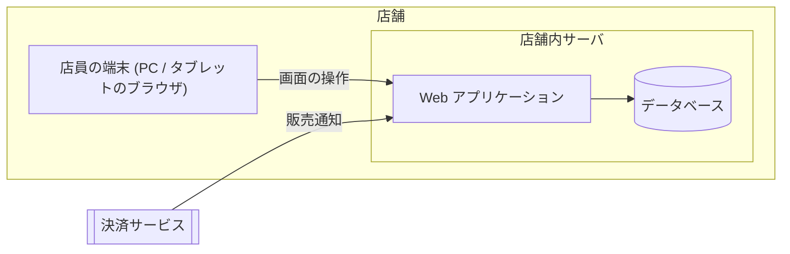

# 配置

Web アプリケーションとデータベースは店舗内の 1 台のサーバに同居させ、店員は店舗の LAN を通じて PC とタブレットのブラウザから利用する ([R15](node:/srs/requirements/non_functional/external_interface/requirements/R15))。対象は単一店舗で、同時利用は 5 名 ([R17](node:/srs/requirements/non_functional/quality/requirements/R17))、書籍は 1 万件程度 ([R16](node:/srs/requirements/non_functional/quality/requirements/R16)) であり、1 台で十分に賄える。サーバの冗長化は行わず、障害時の復旧はデータベースのバックアップからの復元による。

決済サービスからの販売通知は、店舗の回線を通じて Web アプリケーションに届く。回線が途絶えている間は通知が届かないが、販売反映 ([UC04](node:/srs/requirements/functional/UC04)) 以外のユースケースは店舗内で完結するので、在庫の参照と入荷登録は続けられる ([R19](node:/srs/requirements/non_functional/design_constraint/requirements/R19))。途絶えている間に生じた販売の通知をどう届け直すかは決済サービスとの取り決めに委ね、本書では扱わない。
