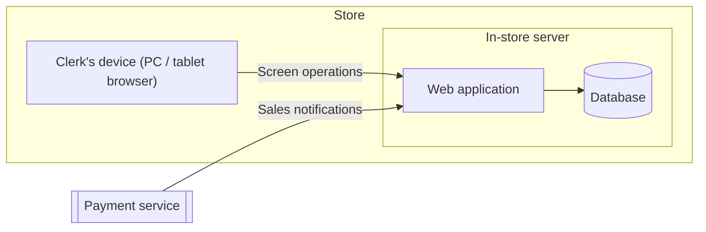

# Deployment

The web application and the database share one server inside the store, and clerks use the system from the browsers of PCs and tablets over the store's LAN ([R15](node:/srs/requirements/non_functional/external_interface/requirements/R15)). The subject is a single store with 5 concurrent users ([R17](node:/srs/requirements/non_functional/quality/requirements/R17)) and about 10,000 books ([R16](node:/srs/requirements/non_functional/quality/requirements/R16)), well within what one server can handle. The server is not made redundant; recovery from a failure is by restoring the database from backup.

Sales notifications from the payment service reach the web application over the store's connection. While the connection is down no notification arrives, but every use case other than sales posting ([UC04](node:/srs/requirements/functional/UC04)) completes inside the store, so stock inquiries and delivery registration can continue ([R19](node:/srs/requirements/non_functional/design_constraint/requirements/R19)). How the notifications of sales made while the connection was down are delivered later is left to the agreement with the payment service and is not covered by this document.
